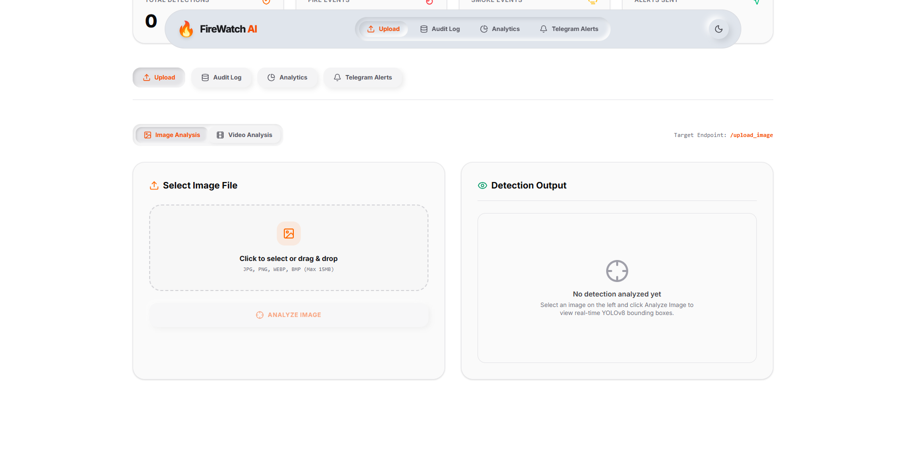
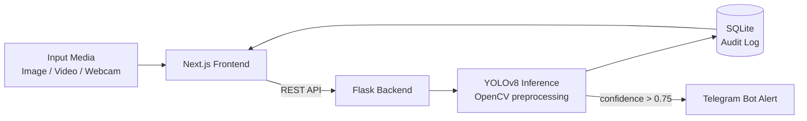

<div align="center">


<br>

[](https://git.io/typing-svg)

<p>
<a href="https://fire-watch-ai-ten.vercel.app"></a>


</p>

</div>

<br>

## Overview

**FireWatch AI** is an end-to-end computer vision platform that detects **fire** and **smoke** in images and videos using **YOLOv8**. Detections are logged to a database for auditing and analytics, and a **Telegram Bot** dispatches an alert to responders the moment fire confidence crosses a critical threshold.

The system is split into a lightweight **Flask inference API** and a modern **Next.js web interface**, making it easy to deploy, scale, and integrate.

| | |
|---|---|
| **Detection classes** | Fire, Smoke |
| **Input sources** | Image upload, video upload, live webcam feed |
| **Alert trigger** | Fire confidence > 0.75 |
| **Alert channel** | Telegram Bot API |
| **Logging** | SQLite audit trail with detection metrics and coordinates |

<br>

## Key Features

- **Multi-source detection:** analyze uploaded images, video files, or a live webcam stream
- **Real-time alerts:** instant Telegram notifications when fire is detected above the confidence threshold
- **Audit log:** every detection is recorded with metrics and bounding-box coordinates
- **Analytics dashboard:** live counters for total detections, fire events, smoke events, and alerts sent
- **Production-ready UI:** drag-and-drop upload, image/video analysis tabs, and light/dark mode
- **Deployable architecture:** frontend on Vercel, backend on Render (`render.yaml` included)

<br>

## Interface

<div align="center">


<br>

<sub>FireWatch AI platform: upload, audit log, analytics, and Telegram alert views.</sub>

</div>

<br>

## Detection Output

<div align="center">


<br><br>


</div>

<br>

### Real-Time Detection and Alerting

<table>
<tr>
<td align="center" width="50%">

<br><sub><b>Live Detection Feed</b></sub>
</td>
<td align="center" width="50%">

<br><sub><b>Telegram Alert Notification</b></sub>
</td>
</tr>
</table>

> [!NOTE]
> Alerts are triggered when fire is detected with confidence greater than **0.75** and are delivered instantly through the Telegram Bot API.

<br>

## System Architecture



| Stage | Description |
|---|---|
| **1. Input** | User uploads an image or video, or connects a live feed |
| **2. Inference** | YOLOv8 processes frames (640×640 input) and detects Fire `[0]` and Smoke `[1]` |
| **3. Audit logging** | Detection metrics and coordinates are written to SQLite |
| **4. Notification** | Telegram bot dispatches an immediate alert to responders |

<br>

## Tech Stack

<div align="center">


</div>

| Layer | Technology |
|---|---|
| **Model** | Ultralytics YOLOv8 (PyTorch) |
| **Computer Vision** | OpenCV |
| **Backend** | Python, Flask |
| **Frontend** | Next.js, React |
| **Database** | SQLite |
| **Alerts** | Telegram Bot API |
| **Deployment** | Vercel (frontend), Render (backend) |

<br>

## Model Evaluation

### Performance Summary

| Class | Images | Instances | Precision | Recall | mAP@0.5 | mAP@0.5:0.95 |
|---|---|---|---|---|---|---|
| **All** | 1722 | 2275 | 0.907 | 0.854 | 0.923 | 0.650 |
| **Fire** | 887 | 1002 | 0.943 | 0.914 | 0.963 | 0.732 |
| **Smoke** | 498 | 1273 | 0.871 | 0.794 | 0.883 | 0.567 |

### Metric Curves

<table>
<tr>
<td align="center" width="50%"><b>F1-Confidence</b><br></td>
<td align="center" width="50%"><b>Precision-Recall</b><br></td>
</tr>
<tr>
<td align="center" width="50%"><b>Precision-Confidence</b><br></td>
<td align="center" width="50%"><b>Recall-Confidence</b><br></td>
</tr>
</table>

### Confusion Matrix and Training Results

<div align="center">


</div>

<br>

## Project Structure

```text
FireWatchAI/
├── FireDetectionApp/      # Flask backend: YOLOv8 inference, logging, Telegram alerts
├── firewatch-landing/     # Next.js frontend and landing page
├── Trained-Models/        # Trained YOLOv8 weights
├── Training NoteBook/     # Model training notebook
├── Final results/         # Evaluation outputs and result artifacts
├── trainValBatch-Img/     # Training / validation batch samples
├── render.yaml            # Render deployment configuration
└── README.md
```

<br>

## Getting Started

### Prerequisites

- Python 3.8+
- Node.js 18+
- A Telegram bot token and chat ID (for alerts)

### 1. Clone the repository

```bash
git clone https://github.com/Dhruvesh05/FireWatchAI.git
cd FireWatchAI
```

### 2. Run the backend

```bash
cd FireDetectionApp

# Create and activate a virtual environment
python -m venv venv
source venv/bin/activate        # macOS / Linux
venv\Scripts\activate           # Windows

# Install dependencies and start the API
pip install -r requirements.txt
python app.py
```

### 3. Configure Telegram alerts

Set the following environment variables before starting the backend:

```bash
TELEGRAM_BOT_TOKEN=<your-bot-token>
TELEGRAM_CHAT_ID=<your-chat-id>
```

### 4. Run the frontend

```bash
cd firewatch-landing
npm install
npm run dev
```

The app will be available at `http://localhost:3000`.

<br>

## Roadmap

- [ ] Multi-camera and RTSP stream support
- [ ] GPS-tagged alerts with map visualization
- [ ] Email / SMS alert channels
- [ ] Model optimization for edge devices (ONNX / TensorRT)
- [ ] Docker Compose setup for one-command deployment

<br>

## Acknowledgements

- **Dataset:** [D-Fire Dataset](https://github.com/gaiasd/DFireDataset)
- **Reference:** [Stay Ahead of the Flames: Wildfire Detection with YOLOv8](https://medium.com/institute-of-smart-systems-and-ai/stay-ahead-of-the-flames-a-comprehensive-guide-to-wildfire-prevention-with-yolov8-3eb8edd1121a)
- **Model framework:** [Ultralytics YOLOv8](https://github.com/ultralytics/ultralytics)
- Based on the open-source [Forest-fire-detection](https://github.com/thilak-r/Forest-fire-detection) project (Apache 2.0).

<br>

## License

Distributed under the Apache License 2.0. See `LICENSE` for details.

<br>

<div align="center">

**Built by [Dhruvesh Patil](https://github.com/Dhruvesh05)**

<a href="https://www.linkedin.com/in/dhruvesh-patil-a31917280/"></a>
<a href="mailto:dhruveshpatil7777@gmail.com"></a>

<br><br>


</div>
